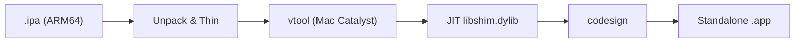

# ipa2mac

Convert non-encrypted ARM64 iOS apps (`.ipa`) into standalone macOS `.app` bundles under stock SIP.

[-purple?style=flat-square)](#)
[](#)
[-blue?style=flat-square)](#)
[](#)
[](LICENSE)

`ipa2mac` repackages legally obtained, non-encrypted 64-bit iOS apps and games to run natively on Apple Silicon via Mac Catalyst (`LC_BUILD_VERSION` platform 6) and per-app micro-shims (`libshim.dylib`). No kernel extensions, no root, no SIP bypass.

> **Alternative:** [PlayCover](https://github.com/PlayCover/PlayCover) is a great project with a full GUI and keymap ecosystem. `ipa2mac` takes a different, minimal path: Mac Catalyst retagging + standalone `.app` bundles with zero background daemons.
>
> **iOS 1–6 (32-bit ARMv7):** Apple Silicon has no 32-bit ARM hardware support. For legacy iOS 1–6 apps, use a CPU emulator like [touchHLE](https://github.com/touchHLE/touchHLE).

---

## Quick Start

**Requirements:** Apple Silicon Mac (`arm64` only — 32-bit `armv7` and `x86_64` are not supported), macOS 12+, Xcode Command Line Tools (`xcode-select --install`).

```bash
git clone https://github.com/noname122021/ipa2mac
cd ipa2mac
```

**Interactive (Finder):** double-click `ipa2mac.command` and drop your `.ipa` into the terminal:

```text
=================================================
           ipa2mac — iOS to Mac Converter
=================================================

Drag and drop your non-encrypted 64-bit .ipa file here:
> /path/to/App.ipa
```

**CLI:**

```bash
python3 engine/patch_app.py /path/to/App.ipa [output_dir]
```

The patched `.app` is written next to the `.ipa` (or to `output_dir`) and can be launched from Finder.

---

## How It Works



1. **Unpack & Validate** — Extracts the `.ipa`, verifies the binary is not FairPlay-encrypted, and thins universal binaries to `arm64`.
2. **Platform Retagging** — Changes Mach-O `LC_BUILD_VERSION` from iOS (`2`) to Mac Catalyst (`6`) across the executable, frameworks, and dylibs using `vtool`.
3. **Shim Injection** — Compiles only the modules enabled in `recipes/<bundle_id>.ini` into `libshim.dylib` and injects `@executable_path/libshim.dylib`.
4. **Sign** — Updates `Info.plist` (`MacOSX`, `UIDeviceFamily`) and applies ad-hoc `codesign`.

---

## Tested Apps & Games

| App / Game | Engine | Input | Status |
|---|---|---|---|
| **Red Dead Redemption** | RAGE | Virtual Gamepad (`WASD` + Mouse) | Working |
| **Genshin Impact** (Native & Cloud) | Unity / Cloud | `keyboard_touch` (PlayCover map) | Working |
| **Zenless Zone Zero** | Unity | `keyboard_touch` (PlayCover map) | Working |
| **Real Racing 3** | Mint3 | Virtual Gamepad (`WASD` + `M`) | Working |
| **Infinity Blade II** | Unreal Engine 3 | Mouse / Touch | Working |
| **LIMBO** | Playdead C++ | Keyboard | Working |
| **Monument Valley** | Unity | Mouse / Touch | Working |
| **Badland** | Custom | Keyboard / Mouse | Working |
| **VLC for iOS** | Native UIKit | Native Mac | Working |

Full list: [COMPATIBILITY.md](COMPATIBILITY.md).

---

## Philosophy: Per-App Recipes & AI-First

Every iOS app breaks in its own way on Mac Catalyst (device checks, Game Center loops, missing APIs, touch-only controls). Instead of one giant universal wrapper, `ipa2mac` uses **per-app recipes** (`recipes/<bundle_id>.ini`, similar to CrossOver/Wine) built from small, composable C/ObjC micro-modules (`engine/modules/`).

- **AI-First Workflow:** Adding support for a new game is designed to be done with an AI coding agent. Give your agent [docs/AGENT_ONBOARDING_PROMPT.md](docs/AGENT_ONBOARDING_PROMPT.md) and your `.ipa` — it will inspect the binary, pick existing modules or write a minimal new one, and generate a shareable `.ini` recipe.
- **No Bloat:** Only the modules enabled in the recipe are JIT-compiled into `libshim.dylib` for that app.

---

## Controls & Input

Depending on the game, recipes use one of three input modes:
- **Virtual Gamepad (`virtual_gamepad`)** — emulates an MFi `GCController` from keyboard and mouse (e.g., Red Dead Redemption, Real Racing 3).
- **Keyboard-to-Touch (`keyboard_touch`)** — maps keys and mouse movement to screen touches, similar to PlayCover (e.g., Genshin Impact, Zenless Zone Zero).
- **Direct Mouse / Touch** — native Catalyst pointer input.

When `keyboard_touch` is active:
- **`~` (Tilde) / `F12`** — toggle on-screen key overlay.
- **Left `Option`** — toggle typing mode (pauses keymapping for chat/text fields).
- **Right `Option`** — toggle mouse camera mode (locks and hides cursor).

---

## Data & Caches (`portable_home`)

By default, converted apps store `Documents`, `Library/Caches`, and downloaded assets in `~/Library/Containers/<bundle_id>/Data`. When `portable_home = true` is enabled in a recipe, `ipa2mac` redirects the app's home to `<AppName>_Data` right next to the `.app` — all game downloads go there, and you can drop or symlink large ODR/asset caches directly into `<AppName>_Data`.

---

## Recipes & Modules

Per-app fixes live in `recipes/<bundle_id>.ini` (see [COMPATIBILITY.md](COMPATIBILITY.md) for tested titles). Modules in `engine/modules/` handle window sizing (`mod_window`), virtual gamepad (`virtual_gamepad`), keyboard-to-touch (`keyboard_touch`), portable data containers (`portable_home`), and legacy iOS API stubs.

---

## License

Released under the [MIT License](LICENSE). All converted apps, trademarks, and game assets belong to their respective owners; `ipa2mac` does not distribute any `.ipa` files or copyrighted binaries.
